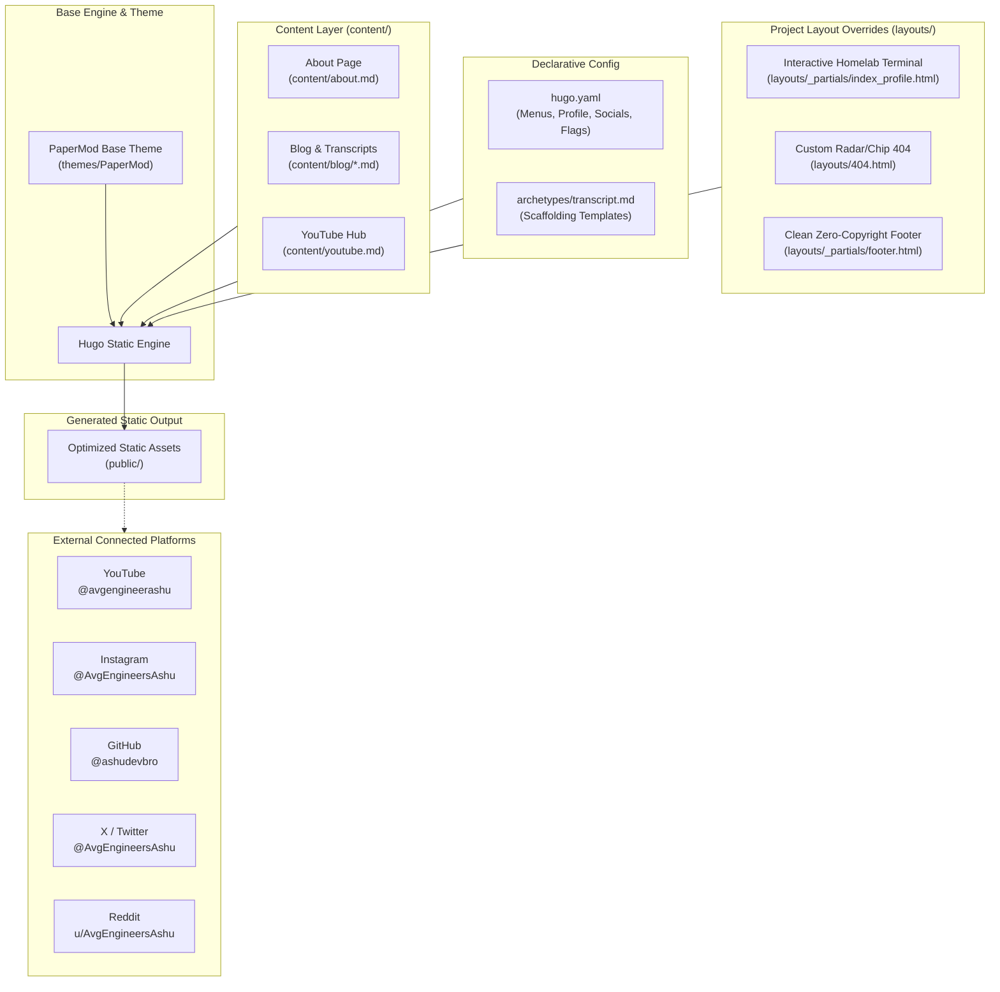

# AvgEngineersAshu — Portfolio & Content Hub 🚀

Welcome to the official source code for **AvgEngineersAshu**'s portfolio and content hub. Built entirely with **Hugo** and the **PaperMod** theme, this site serves as the official homepage, hardware & homelab showcase, and written transcript repository for content explored across **YouTube** and **Instagram**.

---

## 🏗️ Project Architecture



---

## 📂 Repository Structure

```text
.
├── AGENTS.md                  # Strict operational & privacy rules for AI agents
├── archetypes/
│   ├── default.md             # Default page template
│   └── transcript.md          # Scaffold archetype for video/reel transcripts
├── content/
│   ├── about.md               # About page (bio, homelab, tech stack, philosophy)
│   ├── blog/
│   │   └── _index.md          # Blog & transcripts section index
│   └── youtube.md             # Dedicated YouTube channel hub
├── layouts/                   # Project-level theme overrides (clean & upgrade-safe)
│   ├── 404.html               # Custom animated radar/chip 404 page
│   └── _partials/
│       ├── footer.html        # Clean footer without copyright notices
│       └── index_profile.html # PaperMod profile card + Interactive Homelab Terminal
├── hugo.yaml                  # Declarative site configuration & menus
├── themes/
│   └── PaperMod/              # Upstream PaperMod theme
└── .gitignore                 # Ignores build artifacts (public/, cache locks)
```

---

## ⚡ Quick Start & Local Development

### Prerequisites
- **Hugo** (Extended version recommended, v0.146.0+)

### Commands

```bash
# 1. Start the local development server with drafts enabled
hugo server -D

# The site will be available at:
# http://localhost:1313/

# 2. Production build (minified, with garbage collection)
hugo --gc --minify
```

---

## 📖 How to Add New Content in Each Section

### 1. Adding a New Blog Post or Video Transcript
Every video from YouTube or Instagram gets a companion write-up in `/blog/`.

To create a new transcript using the predefined archetype:
```bash
hugo new content/blog/your-topic-slug.md -k transcript
```

This creates a new markdown file in `content/blog/` pre-formatted with:
```yaml
---
title: "Your Topic Title"
date: 2026-10-12T00:00:00+05:30
draft: false
description: "Brief summary of the video topic."
summary: "Short teaser for list views."
tags: ["system-design", "backend", "homelab"]
categories: ["YouTube Transcripts"]
showToc: true
videoUrl: "https://www.youtube.com/@avgengineerashu"
platform: "YouTube" # or "Instagram"
---

> **Watch on Platform**: [Watch on YouTube](https://www.youtube.com/@avgengineerashu)  
> **Topic**: Topic Name  

---

## Overview & TL;DR
...

## Transcript & Notes
...

## Key Takeaways
...
```

When you are ready to publish, ensure `draft: false`.

---

### 2. Updating the YouTube Hub
The YouTube page lives at [`content/youtube.md`](content/youtube.md).

To add a new featured playlist or video series:
1. Open [`content/youtube.md`](content/youtube.md).
2. Add a new row to the **Featured Series & Playlists** table:
   ```markdown
   | **New Series Title** | Description of the topics covered in this series. | [View Transcripts](/blog/tags/your-tag/) |
   ```
3. Save the file. Hugo hot-reloads automatically.

---

### 3. Updating the About Page (Hardware, Rig, Tech Stack)
The About page lives at [`content/about.md`](content/about.md).

- **Hardware updates**: Update the `## 🖥️ The Lab & Hardware Playground` section when your daily driver or homelab setup changes.
- **Tech Stack updates**: Add new languages, tools, or frameworks under `## 🛠️ The Tech Arsenal`.
- **Current Pursuits**: Keep your active focus fresh under `## 🧪 Current Focus & Side Quests`.

---

### 4. Adding New Commands to the Homepage Terminal
The interactive terminal lives in [`layouts/_partials/index_profile.html`](layouts/_partials/index_profile.html).

To add a new command (e.g., `projects`):
1. Open [`layouts/_partials/index_profile.html`](layouts/_partials/index_profile.html).
2. Locate the `const commands = { ... }` JavaScript object.
3. Add your new command function:
   ```javascript
   projects: function() {
       return `Active Projects:
     • Homelab automation scripts
     • Autonomous AI agent workflows
     • Portfolio hub & transcript pipeline`;
   },
   ```
4. Add the command description to the `help` function in the same object.
5. *(Optional)* If you want a quick-click chip button above the terminal, add:
   ```html
   <button type="button" class="chip" data-cmd="projects">projects</button>
   ```

---

### 5. Updating Social Links or Navigation Menus
Social links and menus are configured declaratively in [`hugo.yaml`](hugo.yaml):

```yaml
# To add or update social icons:
params:
  socialIcons:
    - name: youtube
      url: "https://www.youtube.com/@avgengineerashu"
    - name: github
      url: "https://github.com/ashudevbro"
    - name: instagram
      url: "https://www.instagram.com/AvgEngineersAshu"
    - name: x
      url: "https://x.com/AvgEngineersAshu"
    - name: reddit
      url: "https://www.reddit.com/user/AvgEngineersAshu"
```

---

## 🛠️ GitOps & Source Control Guidelines

1. **Submodules**: `themes/PaperMod` is maintained as an upstream theme. Track customizations in `layouts/`, never by modifying theme files directly.
2. **Ignored Artifacts**: Build output directories (`public/`, `resources/`, `.hugo_build.lock`) are ignored by Git.
3. **Agent Rules**: Any AI assistant or agent working on this repo must follow the non-negotiable rules in [`AGENTS.md`](AGENTS.md) (strict tech stack immutability, zero unapproved personal info, and strict user-gated commits).
